<p align="center">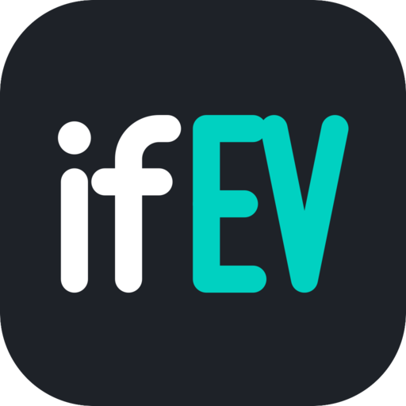</p>

<h1 align="center">이프EV (IfEV)</h1>

<p align="center"><b>지금 타는 내 차로 4주 동안 '가상 전기차'를 타 보는 Pleos Connect 앱</b><br>
내 생활에 전기차가 맞는지, 무엇이 바뀌면 맞게 되는지 차 안의 순간마다 알려 줍니다.</p>

<p align="center">
<a href="https://github.com/SungHyunC/ifev/releases/download/demo-2026-11-12/IfEV_demo.mp4"><b>▶ 시연 영상 (5분 3초)</b></a> ·
<a href="https://github.com/SungHyunC/ifev/releases/download/demo-2026-11-12/IfEV_release.apk"><b>APK 받기</b></a> ·
<a href="#실행-방법">실행 방법</a> ·
<a href="docs/공개데이터_검증.md">공개 데이터 검증</a>
</p>

<p align="center">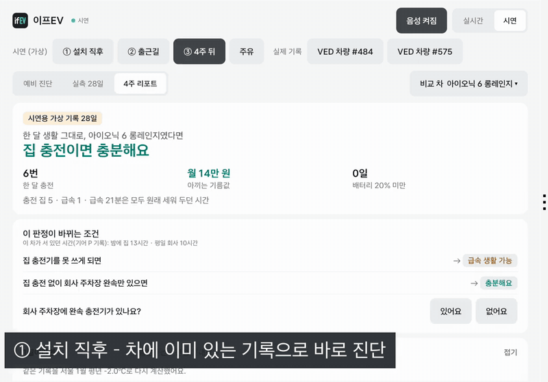</p>

<p align="center"><a href="https://github.com/SungHyunC/ifev/releases/download/demo-2026-11-12/IfEV_demo.mp4">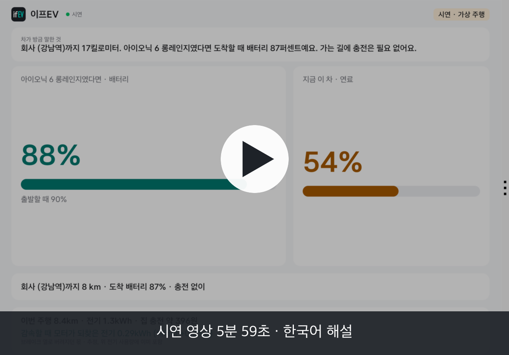</a><br>
<sub>영상은 에뮬레이터 화면 녹화에 한국어 해설과 자막을 넣었습니다. 시연의 4주 기록은 가상 데이터이고, 화면에 그렇게 표시합니다. 저장소의 <a href="demo/IfEV_demo.mp4"><code>demo/IfEV_demo.mp4</code></a>와 같은 파일입니다.</sub></p>

## 한눈에 보기

| 메인: 가상 전기차 (정차) | 주행 중 · 1초에 한 번 갱신 | 감속하면 모터가 되찾는 전기 |
|---|---|---|
| 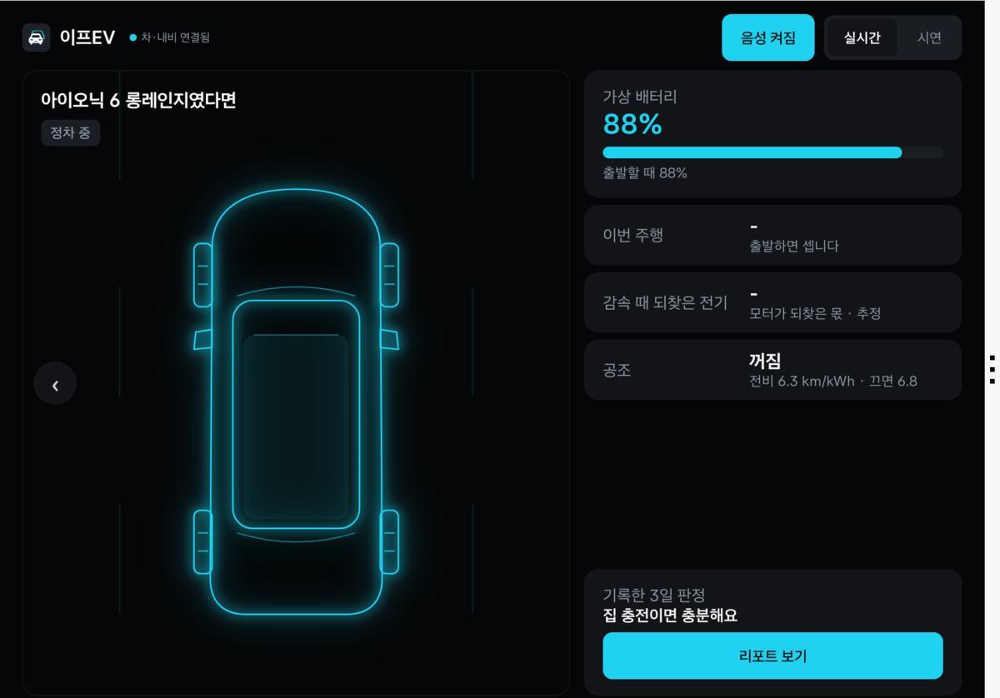 | 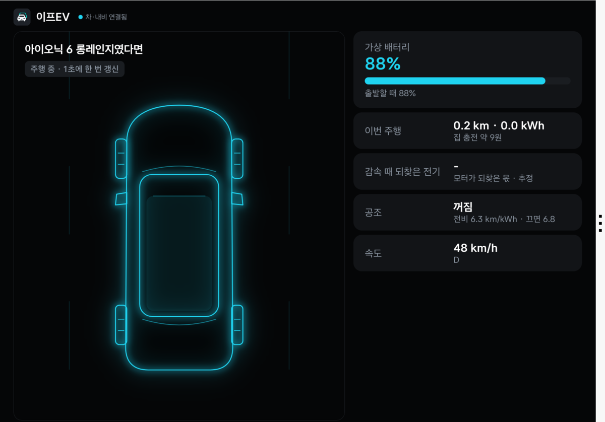 | 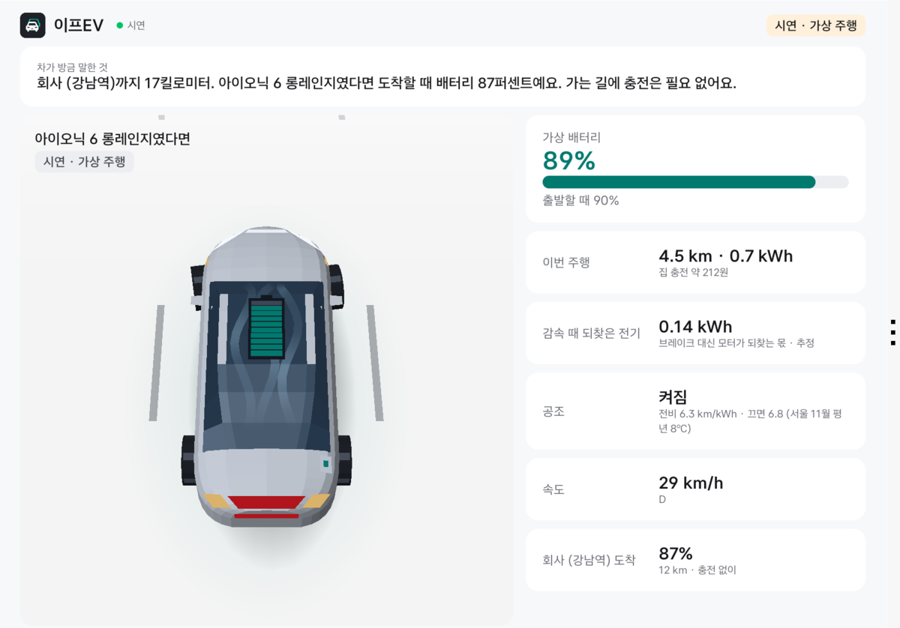 |
| 위에서 내려다본 가상 전기차와 같은 내용의 숫자. 판정과 `리포트 보기`는 정차 중에만 | D로 출발하면 주행 제한(NO_VIDEO)에 맞춰 초당 1번만 다시 그리고 누를 것이 사라짐. 조향·브레이크등·지시등은 실제 차량 신호 | 브레이크를 밟으면 앞바퀴에서 배터리로 청록 입자가 흐르고 "감속 때 되찾은 전기"가 쌓임 (시연) |

| 방금 주행 다시 보기 | 리포트: 4주 판정 | 판정을 바꾸는 한 가지 |
|---|---|---|
| 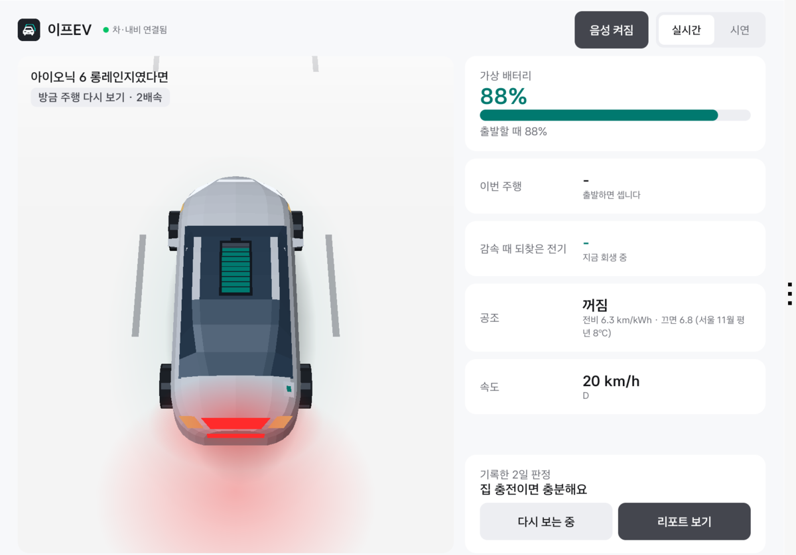 | 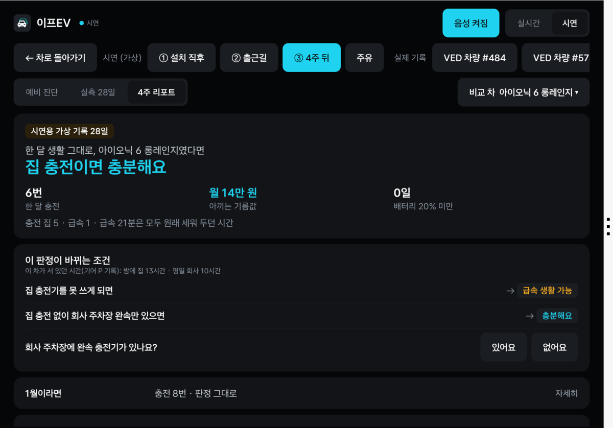 | 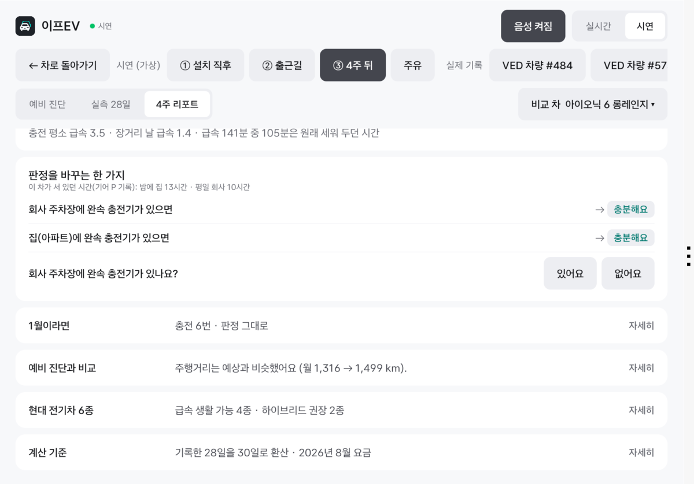 |
| P에 세우면 직전 주행의 실제 신호를 2배속으로 다시 봄 | 판정 한 줄과 숫자 셋, 근거와 표는 접혀 있음 | 기어 P 기록으로 차가 오래 서 있던 곳을 찾아 같은 기록을 다시 계산 → 회사 주차장 완속이면 "충분해요" |

| 설치 직후 예비 진단 | 공개 실주행 데이터 (VED) | 브레이크·방향지시등 |
|---|---|---|
| 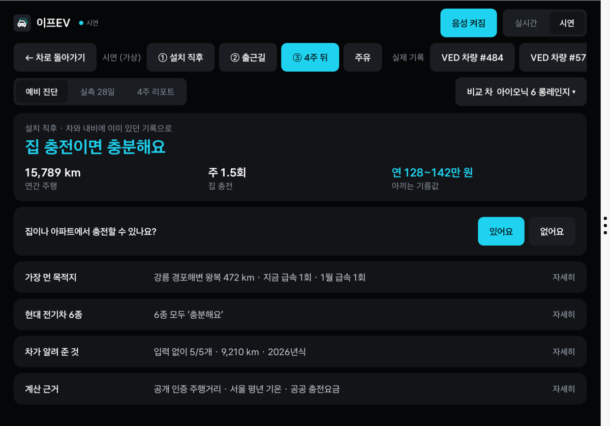 | 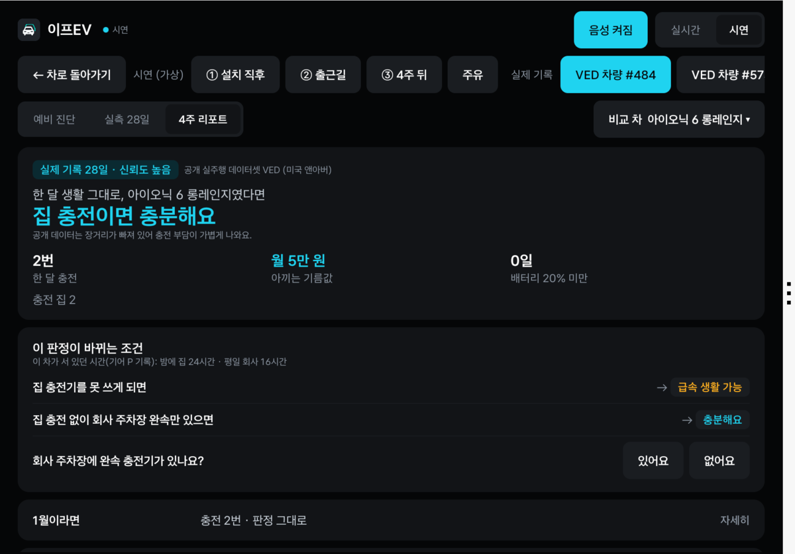 | 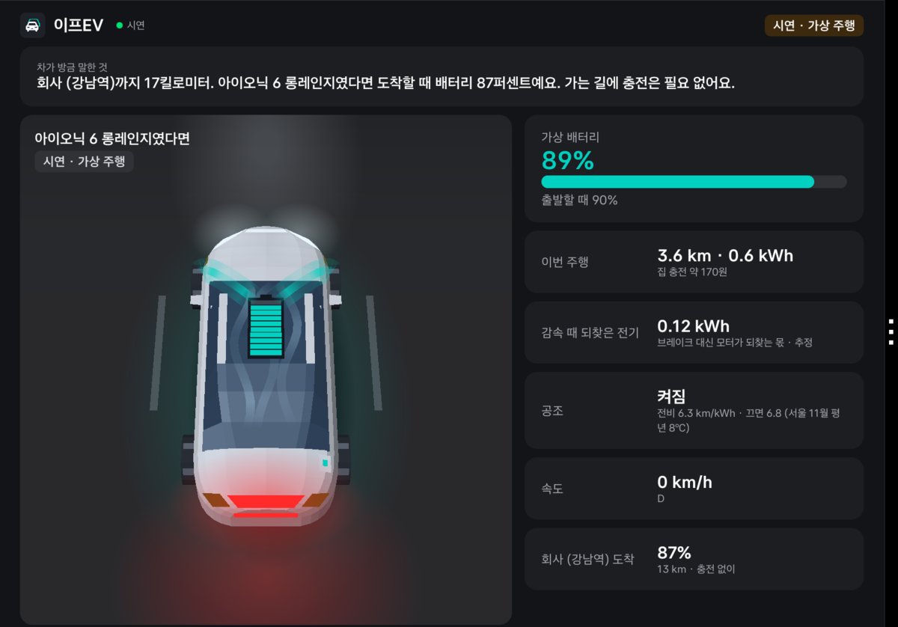 |
| 차와 내비에 이미 있는 기록으로 설치 1분 만에 | 미국 공개 데이터셋 가솔린차의 실제 4주를 같은 엔진으로 | 브레이크는 뒤가 빨갛게, 방향지시등은 그쪽 모서리가 호박색으로 깜박임. 앞바퀴는 조향만큼 꺾임 |

**밝은 테마(낮)** — 위 화면은 어두운 테마(밤)입니다. 차의 주간/야간 설정을 따라 자동으로 바뀝니다.

| 메인 (정차) | 시연 주행: 브레이크·회생 | 리포트: 4주 판정 |
|---|---|---|
| 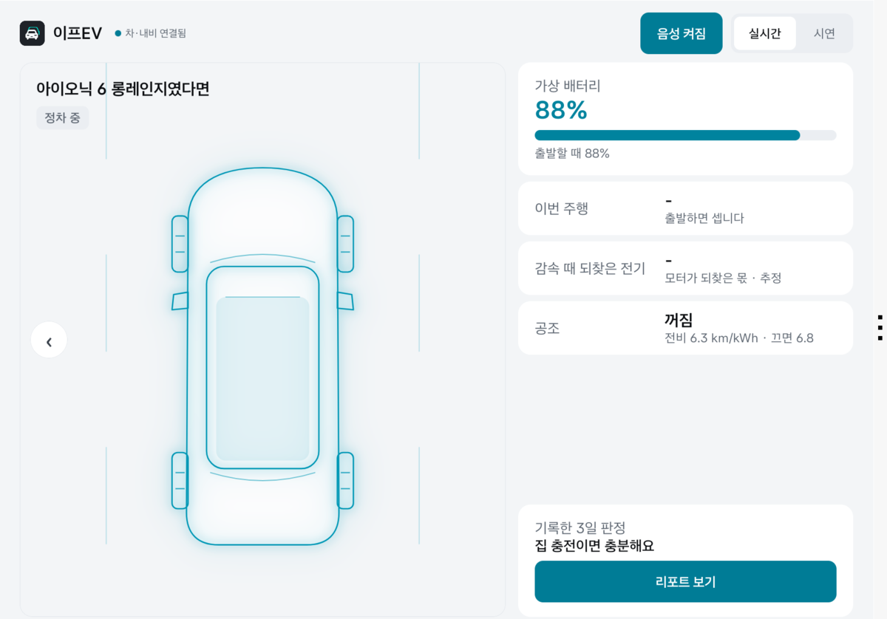 | 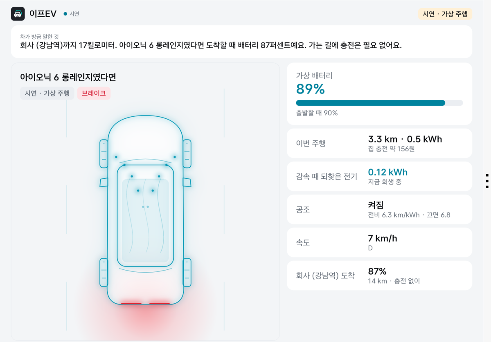 | 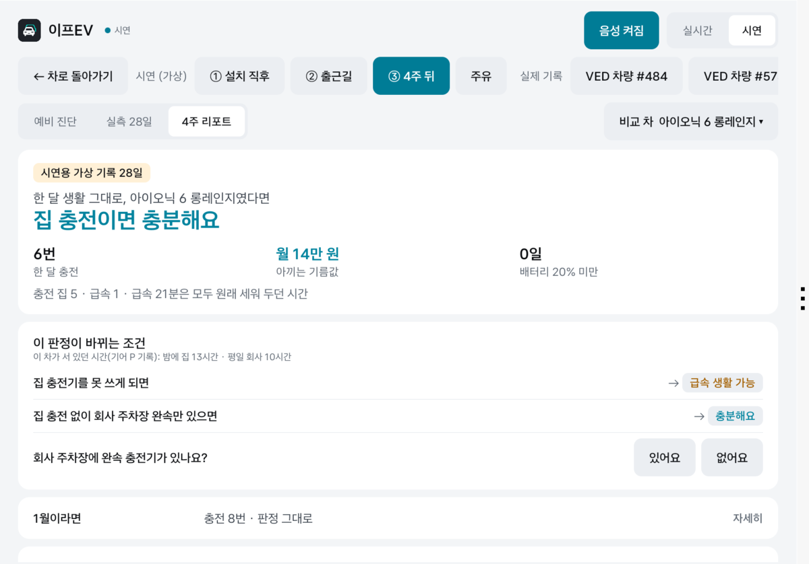 |

전체 화면 캡처 19장(어두운 테마 15장, 밝은 테마 4장)은 [`demo/`](demo/)에 있습니다.

## 소개

**지금 타는 내 차로 4주 동안 '가상 전기차'를 타 보는 Pleos Connect 앱입니다.** 설치 직후에는 차와 내비에 이미 있는 기록으로 **예비 진단**을 바로 보여 줍니다. 목적지를 찍을 때와 정차할 때는 "이 차가 전기차였다면"을 한 문장으로 말해 줍니다. 2~4주 동안 자동으로 쌓인 주행으로 **4주 실측 진단**을 만들어 충전 횟수, 비용, 배터리 걱정을 예비 진단과 비교합니다. 판정에서 멈추지 않고, 같은 기록을 한 가지만 바꿔 다시 돌려 **무엇이 바뀌면 판정이 바뀌는지**(회사 주차장 완속, 집 충전기, 큰 배터리)도 알려 줍니다. 현대자동차그룹 차량용 앱 개발 공모전 출품작입니다.

## 왜 필요한가

- 전기차 구매를 망설이게 하는 요인(신차 구매 예정자 450명, 복수 응답): 충전 인프라 부족 45.3%, 충전 시간 32.8%, 주행거리 불안 29.3% (차봇모빌리티, 2026.2).
- 그런데 실제 전기차 보유자 431명 중 충전 불편 때문에 구매를 후회한다는 응답은 0.9%였습니다 (컨슈머인사이트·워터, 2025.7).
- 구매 전 불안과 실제 경험 사이의 간극을 **내 차의 실제 기록**으로 메웁니다. 휴대폰 계산기는 월 주행거리와 연비를 사람이 입력해야 하지만, 차는 언제 어디서 출발해 얼마나 달리고 어디에 몇 시간 서 있었는지, 공조를 켰는지를 압니다.

## 차 안의 순간

| 순간 | 이프EV | 쓰는 신호 |
|---|---|---|
| 설치 직후 | 입력 없이 예비 진단 | 누적 주행거리, 연식, 평균 연비, 내비 즐겨찾기·최근 목적지 |
| 목적지를 찍을 때 | 음성으로 "강릉 경포해변까지 236킬로미터. 아이오닉 6 롱레인지였다면 도착할 때 배터리 43퍼센트예요."를 말함. 충전이 필요하면 횟수·시간, 1월 기준도 함께 | NaviHelper 목적지·남은 거리·시간 |
| 달리는 동안 | 가상 배터리 하나만 크게. 터치 요소 없음 | 기어, 차속, 공조 |
| 감속할 때 | **가상 회생제동**: 차속이 줄 때마다 전기차였다면 모터가 되찾았을 전기를 쌓아 보여 줌(추정, 주행 전력 안의 분해로만 표시하고 더하지 않음). 정차 문장에도 "그중 0.6은 감속할 때 모터가 되찾은 몫"을 붙임 | AAOS 차속 |
| P에 넣을 때 | 음성으로 "방금 17킬로미터. 전기 2.7킬로와트시, 집 충전으로 약 792원이에요."를 말하고 주행을 저장함 | 기어, 거리, 공조 비율 |
| 세워 둔 다음 출발 | "세워 둔 사이 집에서 90%까지 충전하고 출발" | P단 시각, 집 위치 |
| 주유하는 순간 | 연료량이 8%p 넘게 오르면 주유로 보고, 지난 주유 뒤 달린 거리의 기름값과 전기차 충전비를 말함 | Fuel 연료량 |
| 장거리에서 쉬는 동안 | 급속 충전이 휴게소·목적지에 원래 세워 두던 시간과 겹치면 "추가로 기다린 시간"으로 세지 않음. 쉬고 출발할 때 "방금 24분 쉬셨죠. 그 사이 급속으로 80%까지 채웠다고 셌어요. 따로 기다린 시간은 없어요."를 말함 | P 시각·머문 시간 |
| 4주 뒤 | 4주 리포트, **겨울 미리 보기**(같은 기록을 서울 1월 평년 기온으로 재계산), **판정을 바꾸는 한 가지**, 현대 전기차 6종 비교 | 기록 전체 |
| 전기차로 바꾼 뒤 | **예측 성적표**: 차 배터리가 실제로 쓴 kWh와 이프EV 예측을 비교 | EvBattery, AAOS 배터리 잔량 |

## 메인 화면: 가상 전기차 탑뷰

메인 화면은 **위에서 내려다본 가상 전기차 한 대**입니다. 3D 모델 대신 아이콘의 청록색(#1FD3F0) **네온 윤곽선**으로 그립니다(팀 디자인 시안 기준). 화면은 **어두운 테마**(검은 바탕, 시안 그대로)와 **밝은 테마**(연회색 바탕, 흰 바탕에서도 읽히도록 청록을 조금 진하게) 두 가지이고, 차의 주간/야간 설정을 따라 자동으로 바뀝니다. 이 차의 실제 신호로 움직이고, 같은 내용을 오른쪽에 숫자로 보여 줍니다. 판정·충전 횟수·절감액은 정차 중에만 `리포트 보기`(또는 왼쪽 `‹`)로 여는 별도 화면에 있습니다.

| 가상 전기차에서 보이는 것 | 오른쪽 숫자 | 연결된 신호·값 |
|---|---|---|
| 앞바퀴 조향 | – | Pleos `SteeringWheel` |
| 바퀴 회전·차선 흐름 (정차 중 재생·시연에서만) | 속도 | AAOS `PERF_VEHICLE_SPEED` 적분 |
| 실내 배터리 채움 (높이, 30% 미만이면 호박색, 이번 주행 소모분은 빈 칸) | 가상 배터리 % | 기존 가상 배터리 계산 |
| 감속할 때 앞바퀴→배터리로 흐르는 청록 입자 | 감속 때 되찾은 전기 kWh | 차속 감소 + 기존 `Regen` |
| 실내 기류 곡선 | 공조 켜짐, 전비(끄면 n) | Pleos HVAC + 기존 `EnergyModel` |
| 브레이크등(빨간 빛) / 방향지시등(호박색 점멸) | 상단 칩 `브레이크`·`왼쪽 방향지시등`·`조향 왼쪽 n°` | Pleos `Brake` / `TurnSignal` |
| – | 이번 주행 km·kWh·원, 목적지 도착 배터리 | 기존 계산, 내비 경로 |

- **주행 중에는 움직이지 않습니다.** Android Automotive는 주행 중 앱에 `NO_VIDEO`(초당 1프레임 넘는 애니메이션 금지) 제한을 겁니다. 이프EV는 `CarUxRestrictions`를 구독해, 제한이 걸리거나 기어가 P가 아니면 탑뷰를 **초당 1번만** 다시 그리고 바퀴 회전·차선 흐름·점멸을 멈춥니다(에뮬레이터 D 주행에서 8초에 17프레임 확인). 터치 요소도 모두 숨깁니다.
- **정차 중에는 움직입니다.** P에서 `방금 주행 다시 보기`를 누르면 직전 주행의 신호(메모리에만 보관, 좌표 없음)를 2배속 60fps로 다시 봅니다. 출발하면 즉시 멈춥니다.
- **실제 차가 우선입니다.** 시연이나 다시 보기 중에 실제 차가 P를 벗어나면 시연·다시 보기를 바로 끝내고 실시간 화면으로 돌아갑니다(독립 검토에서 찾은 문제를 고침).
- **조향 신호**: Pleos SDK 문서는 앞바퀴 각도(왼쪽 음수)라고 하지만, 에뮬레이터는 Virtual Console의 핸들 −150°를 SDK로 +150°로 보냈습니다. 그래서 에뮬레이터에서만 핸들각·부호 반전·조향비 15:1로 읽고, 실차는 SDK 문서대로 읽습니다(실차 확인 필요).
- **구현**: 3D 라이브러리 없이 Canvas에 윤곽선 Path와 `BlurMaskFilter` 글로우로 그립니다(경로·Paint는 크기가 바뀔 때만 만들고 프레임마다 새로 할당하지 않음). APK 증가 0, 에뮬레이터 시연 주행 중 약 60fps(20초 1,252프레임, 지연 3.9%). Filament(+6.9~16MB, 이 빌드 환경에서는 1.75.1이 마지막 호환판)와 비교해 골랐습니다.
- **넣지 않은 것**: "차량 안정성 점수". 차속이 1~10Hz로만 들어와 급가감속 피크를 놓치고, 조향 변화율로는 주차와 곡선을 구분할 수 없어 근거 있는 지표를 만들 수 없었습니다.

**리포트 화면은 답부터 보여 줍니다.** 리포트의 각 탭은 판정 한 줄과 숫자 세 개(예: 한 달 충전 6번 · 월 14만 원 · 20% 미만 0일)가 먼저 나오고, 1월이라면·예비 진단과 비교·차종 비교·계산 근거는 한 줄 요약으로 접혀 있다가 누르면 펼쳐집니다. 묻는 것은 "집에서 충전할 수 있나요?" 하나이고, 비교 차종은 탭 옆 버튼으로 바꿉니다.

음성은 Pleos TextToSpeech SDK의 기기 내 모드(ko-KR)로 말하고, 같은 문장을 화면 위 "차가 방금 말한 것" 카드로도 보여 줍니다. 오른쪽 위 `음성 안내` 버튼으로 끌 수 있습니다. 주행 중에는 화면에 누를 것이 없고, `실시간/시연` 전환과 `음성 안내` 버튼도 숨깁니다.

## 같은 경로, 두 계산 (실시간 검증)

에뮬레이터 차는 전기차(77.4kWh)이고, 현대차 내비는 이 차의 도착 배터리를 직접 계산합니다. 내비에서 목적지를 찍으면 정차 화면 맨 위에 "같은 경로, 두 계산" 카드가 나옵니다. 내비의 도착 배터리와, 이프EV 에너지 모델을 이 차 배터리에 적용한 도착 배터리가 나란히 보입니다. 가상 데이터 없이 이프EV 계산을 현대차 내비와 대조하는 장면입니다.

- 확인한 예(11/12, 에뮬레이터): 강릉 194km, 출발 100%
  - 내비: 도착 64% (6.9 km/kWh)
  - 이프EV: 도착 58% (6.0 km/kWh, 아이오닉 6 롱레인지 전비, 11월 평년 7.5℃, 공조 사용)
  - 이프EV가 6%p 보수적입니다.
- 이프EV는 이 차의 인증 주행거리를 SDK로 읽을 수 없어 고른 비교 차종의 전비를 씁니다. 화면에도 그렇게 표시합니다.

## 판정을 바꾸는 한 가지

"전기차가 맞나요?"에 답한 뒤, 같은 기록을 **한 가지만 바꿔** 다시 재생합니다(`engine/Levers.kt`).

- 먼저 기어 P 기록으로 **차가 오래 서 있던 곳**을 셉니다. 예: 밤에 집 평균 13시간, 평일 낮 회사 평균 10시간(20일).
- 판정이 아쉬우면 바꿀 한 가지를 찾습니다: 회사 주차장 완속(7kW), 집 완속, 한 단계 큰 배터리. 판정이 좋은 쪽부터, 같으면 평소 급속이 적은 쪽부터 보여 줍니다.
- 판정이 좋으면 **무엇이 무너뜨리는지**를 보여 줍니다: 집 충전기를 못 쓰게 되면, 회사 충전기를 못 쓰게 되면.
- 회사에 4시간 넘게 서 있는 날이 2일 이상이면 "회사 주차장에 완속 충전기가 있나요?"를 묻습니다. "있어요"를 고르면 회사 충전을 넣어 판정을 다시 냅니다("회사 주차장 충전이면 충분해요"). 답은 언제든 바꿀 수 있습니다.
- 회사 충전만으로 "충분해요"가 되려면 기록에 회사 장기 정차가 실제로 있어야 합니다. 답만으로는 판정이 오르지 않습니다.

시연 4주(가상) 예: 집 충전 없음이면 "급속 충전을 생활에 넣으면 가능해요"(평소 급속 월 3.5회)입니다. 같은 기록에 회사 주차장 완속을 넣으면 "회사 주차장 충전이면 충분해요"(회사 충전 월 12회, 평소 급속 0회)로 바뀝니다. 캐스퍼는 집 충전이 없으면 "하이브리드 권장"(월 6.6회)인데, 회사 완속이나 집 완속 하나로 "충분해요"가 됩니다.

**BMW·벤츠의 전환 진단과 다른 점**: 그 서비스들은 기록을 모아 "전기차로 다닐 수 있었나"를 폰에서 알려 줍니다. 이프EV에는 세 가지가 더 있습니다. ① 설치 첫날 결과(차와 내비에 이미 있는 기록), ② 목적지를 찍고·주유하고·쉬고·감속하고·정차하는 **차 안의 순간**마다 그 자리에서 말하는 것, ③ 판정에서 멈추지 않고 **차가 원래 서 있던 시간표 위에서 판정을 바꾸는 한 가지**를 찾는 것입니다. 하이브리드가 더 맞으면 하이브리드 절감액도 나란히 보여 줍니다.

## 실제 주행 기록으로 검증하기

시연의 4주 기록은 가상 데이터입니다. 이를 보완하려고 실제 사람의 2~4주 주행을 같은 엔진에 넣는 도구를 함께 둡니다. 절차는 [`docs/실제기록_수집_가이드.md`](docs/실제기록_수집_가이드.md)에 있습니다.

1. 폰 GPS 기록 앱(GPSLogger, Open GPX Tracker)으로 운전할 때만 기록합니다.
2. `tools/gpx_to_trips.py`가 기록을 주행으로 나눕니다. 좌표는 지우고 거리·시간·집/회사/기타만 남깁니다(표준 라이브러리만 사용).
3. `./gradlew :app:testDebugUnitTest --tests '*RealDriveReplay*' -Pdrives=<폴더> --rerun`을 실행하면 `report.md`가 생깁니다.
   - 사람마다 현대 전기차 6종의 판정이 나옵니다.
   - 전기차 차주는 실제 충전량 대비 예측 오차가 함께 나옵니다.
4. `app/src/main/assets/real/<id>/`에 넣고 빌드하면 시연 모드에 **④ 실제 기록** 버튼이 생깁니다. 참가자 기록은 `.gitignore`로 저장소에서 뺍니다.
5. 구글 지도 타임라인을 켜 둔 사람은 기다리지 않아도 됩니다. 타임라인 내보내기(JSON)를 같은 도구에 넣으면 지난 몇 주의 자동차 주행이 바로 나옵니다(형식은 합성 예제 `tools/samples/`로만 확인했고, 실제 내보내기 파일로 다시 확인할 예정).

**공개 실주행 데이터셋(VED)으로 먼저 한 것** — 자세한 내용과 한계는 [`docs/공개데이터_검증.md`](docs/공개데이터_검증.md)
- VED(Vehicle Energy Dataset, 미국 미시간 앤아버 383대, 2017.11~2018.11, Apache-2.0)의 가솔린차 2대 4주를 `tools/ved_to_trips.py`로 바꿔 앱에 넣었습니다. 시연 모드의 **④ VED 차량 #484 / #575** 버튼입니다.
  - 실제 출발·주차 시각, 실제 외기온도, MAF로 계산한 실제 연비를 씁니다. 좌표는 남기지 않습니다.
  - VED는 개인정보 보호로 주행 앞뒤를 지우고 시 경계 밖을 지웠습니다. 그래서 장거리가 빠져 충전 부담이 가볍게 나옵니다(30일 환산 #484 357km, #575 313km). 화면에도 그렇게 적습니다.
- VED의 2013 닛산 리프 3대, 460번 주행으로 **에너지 모델의 기온 반응**을 점검했습니다(`VedLeafCheckTest`). 15~25℃ 대비 리프 실측은 0~5℃ 1.37배, −5~0℃ 1.61배, −5℃ 미만 2.20배였고, 이프EV(아이오닉 6 인증값 기준)는 1.20·1.28·1.37배입니다. **영하의 짧은 시내 주행에서는 이프EV가 적게 잡습니다**(−5℃ 미만 33~40%). 리프 2013은 오래된 난방 방식이라 그대로 옮길 수는 없지만, 겨울 숫자는 하한으로 읽어야 한다는 뜻입니다. 현대 전기차로는 예측 성적표(전기차 차주 기록)로 다시 확인합니다.

## 무엇을 보여 주나

| 단계 | 시점 | 쓰는 데이터 | 보여 주는 것 |
|---|---|---|---|
| ① 예비 진단 | 설치 직후 | 누적 주행거리, 차대번호 연식(타 온 기간 추정, 고칠 수 있음), 평균 연비, 내비 즐겨찾기(집·회사), 최근 목적지 | 연간 주행, 주당 집 충전 횟수(또는 월 급속 횟수), 연료비 절감 범위, 최근 목적지별 "충전 없이 / 급속 n회" (지금·1월) |
| 주행 중 | 매 주행 | 기어, 누적 주행거리, 공조 상태, 위치 | 실제 연료 게이지 옆에 "아이오닉 6였다면 배터리 n%". 조작 없음 |
| ② 실측 기록 | 1~4주 | P에서 P까지의 주행(거리·시간·공조·연비·집/회사/기타) | 실측 일수와 신뢰도, 날짜별 가상 배터리 최저치와 충전, 예비 진단과 달라진 점 |
| ③ 4주 리포트 | 4주 후 | 위 기록 전체 | 30일 기준 충전 횟수, 20% 미만인 날, 절감액, 급속 충전 시간(그중 원래 세워 두던 시간), 겨울 미리 보기, 예비 진단 vs 실제 표, 판정(집 충전이면 충분 / 급속 생활 필요 / 하이브리드가 더 맞음) |

## 계산 방법과 근거

- **비교 차종 (현대 전기차 6종, 인증 1회 충전 주행거리)**

  | 차종 | 배터리 | 상온 (도심·고속) | 저온 | 추정한 값 |
  |---|---|---|---|---|
  | 캐스퍼 일렉트릭 인스퍼레이션 17인치 | 49kWh | 295km (323·262) | 245km | 저온 도심·고속 (아이오닉 6 비율 모양으로 나눔: 237·255km, 공개값 236·256km와 거의 같음) |
  | 코나 일렉트릭 롱레인지 17인치 | 64.8kWh | 417km (454·371) | 307km | 저온 도심·고속 |
  | 아이오닉 5 롱레인지 2WD 19인치 | 84kWh | 485km (533·426) | 미확보 | 저온 전체 (아이오닉 6 롱레인지 저온/상온 비율 80%) |
  | 아이오닉 6 스탠다드 2WD | 63kWh | 442km (476·402) | 387km (375·402) | 없음 |
  | 아이오닉 6 롱레인지 2WD | 84kWh | 568km (609·517) | 453km (429·482) | 없음 |
  | 아이오닉 9 항속형 2WD 19인치 | 110.3kWh | 532km (복합만) | 약 400km (보도 근사치) | 상온 도심·고속 (공개 전비 4.7·3.9·4.3km/kWh 비율), 저온 도심·고속 |

  추정값이 있는 차종은 화면 비교표에 * 표시하고, 계산 근거에 어떤 값을 추정했는지 보여 줍니다.
- **속도**: 주행의 평균 속도로 도심(약 31km/h)과 고속(약 78km/h) 인증 주행거리 사이를 보간합니다.
- **기온**: 20℃에서 상온, -7℃에서 저온 인증값(난방 사용)으로 보간합니다. 공조를 끈 추위는 AAA(2019) -6.7℃ 공조 미사용 -12%를 쓰되, 공조를 끈 쪽이 켠 쪽(차종 저온 인증값)보다 더 짧게 가는 일은 없게 합니다. 더위는 35℃ 에어컨 -17%·미사용 -4%를 씁니다. 외기온도는 SDK에 없어 기상청 서울 월평균기온 평년값(1991~2020)을 씁니다.
- **저온 도심·고속 추정**: 저온 복합만 공개된 차종은 아이오닉 6 롱레인지의 인증 비율 모양(저온에서 도심은 70%, 고속은 93%만 남음)으로 나눈 뒤, 55:45 복합이 공개값과 같아지게 맞춥니다. 추위는 히터 시간이 긴 도심을 더 깎기 때문입니다.
- **충전 습관(가정)**: 집 충전이 되면 집에 4시간 이상 세울 때 50% 아래면 90%까지 채우고, 다음 주행이 100km 이상이면 전날 밤 90%까지 채웁니다. 집 충전이 없으면 30% 아래로 세울 때 공공 급속으로 80%까지 채웁니다. 집이 아닌 곳에 30분 이상 세웠는데 다음 주행에서 20% 아래로 떨어지면 그 자리에서 급속으로 80%까지 채웁니다(장거리 목적지·휴게소). 어떤 주행도 10% 아래로 계획하지 않고, 그 전에 급속 충전(80%까지, 실효 120kW, 대기 5분 추가)을 넣습니다.
- **요금**: 휘발유 1,855원/L(오피넷 2026-11-11 전국 평균). 충전은 2026-08-01 공공 요금: 완속 295원, 급속 325.6~393.1원(100~200kW 348.4원). 아파트 민간 완속 상단 350원을 범위 끝으로 씁니다. 충전 손실은 반영하지 않습니다.
- **판정 기준**: 집 충전 없이 생활 급속이 월 4.5회(주 1회 정도) 이하면 "조건부 적합", 넘으면 "하이브리드가 더 맞음". **연구 근거가 없는 제품 기준**이며 화면에도 그대로 표시합니다. 충전 습관도 가정이며 화면 계산 근거에 표시합니다.
- **30일 환산**: 집 충전이 없을 때 계산은 다음과 같습니다.
  - 생활 급속 횟수: 평소 주행에 쓴 전기를 30%→80% 충전량으로 나눠 셉니다.
  - 장거리 날 급속: 100km 이상 주행에 쓴 전기를 10%→80% 충전량으로 나눠 따로 셉니다. 가는 길과 목적지 충전을 모두 포함합니다.
  - 100km 넘는 주행이 주 1회보다 잦으면 장거리로 따로 빼지 않고 평소 주행으로 셉니다. 매일 110km 출퇴근을 장거리로 빼지 않습니다.
  - 충전 시점에 따라 결과가 달라지지 않고, 기록 첫날의 "공짜" 90% 배터리에도 영향받지 않습니다.
  - 집 충전이 있으면 기록 끝 배터리가 시작(90%)보다 낮은 만큼 충전을 더합니다.
- **주행 거리**: 누적 주행거리가 움직이면 그것을 기준으로 하고, 차속 적분은 한 칸(1km)까지만 더합니다. 위치 궤적은 GPS 잡음으로 늘어나므로 누적 주행거리가 없을 때만 씁니다.
- **신뢰도**: 기록 기간과 함께 운전한 날 수를 봅니다. 28일 이상이고 운전한 날이 12일 이상이어야 "높음"입니다. 한 번 달리고 4주를 쉰 기록은 "낮음"입니다.
- **집 충전 여부를 답하기 전**에는 실측 판정을 내리지 않습니다.
- **내 차 연비**: 차가 기록한 평균 연비(`Fuel`)를 씁니다. 차가 주지 않으면 "지금 타는 차"를 한 번 물어 공인 복합연비(그랜저 2.5 가솔린 11.7km/L, 아반떼 1.6 하이브리드 21.2km/L)로 대신 계산하고, 화면에 출처를 표시합니다. 공인 연비는 실제보다 높게 나오는 편이라 절감액은 작게 계산됩니다.
- **주행 거리 출처**: 주행마다 누적 주행거리 / 차속 적분 / 내비 위치 중 어디서 거리를 얻었는지 저장하고 실측 화면에 "거리 출처"로 보여 줍니다.
- **목적지 거리**: 집에 세워 둔 상태에서는 내비 `requestTrip`으로 실제 도로 거리를 받고, 그 전에는 직선거리 × 1.3으로 추정한 뒤 화면에 "직선거리로 추정"이라고 표시합니다.

## Pleos SDK 사용

모두 **읽기 권한**입니다. 차량 제어(Vehicle Control) 권한은 쓰지 않습니다. 차속은 Vehicle SDK에 없어 AAOS 표준 속성 `PERF_VEHICLE_SPEED`를 씁니다. 기어는 AAOS `GEAR_SELECTION`을 먼저 쓰고, 차가 답하지 않을 때만 Pleos Gear API를 씁니다. [Pleos SDK 정책](https://document.pleos.ai/docs/pleos-only/connect-sdk-pleos/)이 "동일하거나 유사한 기능의 API가 AAOS에 있으면 AAOS에 맞춘다"이고, SDK의 Gear API도 Google `GEAR_SELECTION` 속성을 쓰라고 안내하므로, 그 원칙을 따른 것입니다.

| 목적 | API | 권한 |
|---|---|---|
| 주행 시작·끝 | AAOS `GEAR_SELECTION` (Pleos SDK의 Gear API가 deprecated로 이 속성을 안내함). 차가 답하지 않으면 Pleos `Gear.registerGearSelection`으로 대신함 | android.car.permission.CAR_POWERTRAIN, (대체) CAR_DRIVE |
| 주행 거리, 예비 진단 연간 주행 | `Odometer.registerDistanceDriven`, `getCurrentDistanceDriven` | CAR_DRIVE |
| 연료 게이지, 내 차 연비 | `Fuel.registerFuelPercent`, `registerCurrentFuelEconomy`, `registerCumulativeFuelEconomy` (SDK 단위 L/100km를 km/L로 변환) | CAR_ENERGY |
| 이미 전기차인 차의 배터리 (전환 후 모드 준비) | `EvBattery.registerEvBatteryStateOfCharge`, `getCumulativeEvEfficiency` | CAR_ENERGY |
| 공조 사용 (전기차 소비 보정) | `HVAC.checkHvacPowerCapabilities`, `registerHvacPowerState` | CAR_CLIMATE |
| 주행 거리 보완 | AAOS `CarPropertyManager` `PERF_VEHICLE_SPEED` (Pleos SDK에 차속이 없어 표준 API 사용) | android.car.permission.CAR_SPEED (런타임) |
| 타 온 기간 추정 | `CarInfo.getVINInfo` (10번째 자리 연식만 계산, 저장 안 함) | CAR_INFO |
| 집·회사 | NaviHelper `getBookmarkInfo` (`BookmarkType.HOME`/`OFFICE`) | NAVI_ROUTE |
| 최근 목적지 | `getRecentDestinationInfo` | NAVI_ROUTE |
| 위치 (집/회사 판별, 거리 보조) | `getCurrentLocationInfo` | NAVI_ROUTE |
| 도로 거리 | `requestTrip` → `onTripInfo` | NAVI_ROUTE |
| 목적지를 찍는 순간 | `onDestinationChanged`·`onRoutingCompleted`·`onRouteStarted` → `getDestinationInfo`, `getRouteStateInfo`, `onDrivingInfo` | NAVI_ROUTE |
| 순간의 한 문장 | TextToSpeech SDK 3.3.1 `Mode.ON_DEVICE`, `Locale.KOREA` | TTS_SERVICE |
| 이미 전기차인 차: 내비 계산과 비교 | AAOS `INFO_EV_BATTERY_CAPACITY`, `EV_BATTERY_LEVEL` (Pleos의 용량 API가 deprecated로 이 속성을 안내함), NaviHelper `RouteStateInfo.remainDestinationChargingInt` | android.car.permission.CAR_INFO, CAR_ENERGY |

주행 기록은 포그라운드 서비스(`RecorderService`)가 맡아 내비 등 다른 앱을 보는 동안에도 이어지고, 부팅(시동)과 함께 시작합니다. 주행 중 화면은 게이지 하나뿐이고 조작이 필요 없습니다.

## 개인정보

- 기록은 차 안(앱 저장소)에만 남습니다. 주행마다 거리, 시간, 기온, 공조 비율, 연비, 출발·도착이 집/회사/기타인지만 저장하고 **좌표는 저장하지 않습니다**.
- 차대번호는 연식 계산에만 쓰고 저장하지 않습니다. 앱 코드는 네트워크를 쓰지 않습니다. 다만 TextToSpeech SDK의 매니페스트에 SDK 검증용 인터넷 권한이 들어 있어 합쳐집니다. 음성은 기기 내 모드로 만듭니다.
- 주행 중에는 진행 중인 주행을 10초마다 앱 저장소에 적어 둡니다. 앱이 주행 도중 종료돼도 다시 시작하면 그 주행을 이어서 기록합니다.

## 실행 방법

### 준비
- Android Studio, JDK 21 (`gradle/gradle-daemon-jvm.properties`가 로컬 JDK 21을 찾습니다)
- Pleos Connect Emulator v2.1 (API 34). SDK Manager > SDK Update Sites에 `https://nexus-playground.pleos.ai/repository/raw-releases/connect-avd/2.x/crp-arm64-sys-img.xml` (Windows/Linux는 `crp-sys-img.xml`), AVD RAM 4GB, Cold boot
- 음성을 들으려면 에뮬레이터를 오디오와 함께 켭니다(`-no-audio` 옵션을 쓰면 기기 내 음성 엔진이 오류를 냅니다).

### 빌드·설치
```bash
./gradlew :app:testDebugUnitTest      # 단위 테스트 (191개, 실제 기록 재생은 -Pdrives가 있을 때만)
./gradlew :app:assembleRelease
adb install -r -g app/build/outputs/apk/release/app-release.apk
```

### 실행
```bash
adb shell am start -n com.ifev.app/.MainActivity                    # 실시간 (차량 신호)
adb shell am start -n com.ifev.app/.MainActivity --es demo day0     # 시연 ① 설치 직후
adb shell am start -n com.ifev.app/.MainActivity --es demo drive    # 시연 ② 출근길 주행 (약 1분)
adb shell am start -n com.ifev.app/.MainActivity --es demo weeks    # 시연 ③ 4주 뒤
adb shell am start -n com.ifev.app/.MainActivity --es demo refuel   # 시연: 주유하는 순간
```
앱 오른쪽 위 `시연`을 눌러도 됩니다. 에뮬레이터는 실제로 달리지 않고 즐겨찾기도 비어 있으므로, 시연은 SDK가 주는 것과 같은 형태의 가상 데이터(집·회사, 최근 목적지, 누적 주행거리, P→P 주행 4주치)를 같은 엔진에 넣습니다. 시연 중에도 "집 충전 있어요/없어요", 기간, 비교 차종을 바꾸면 결과가 바로 바뀝니다.

### 실시간 신호로 시험하기 (Virtual Console)
```bash
adb forward tcp:8088 tcp:8088
```
브라우저에서 `http://127.0.0.1:8088/` → Emulation Controls에서 Gear를 D로 바꾸면 주행 화면(가상 배터리 게이지)으로, P로 바꾸면 정차 화면으로 돌아오며 정차 문장을 말합니다.

### 목적지를 찍는 순간 시험하기
에뮬레이터 내비에서 목적지를 검색해 `안내 시작`을 누르면, 이프EV가 목적지와 남은 거리·시간을 받아 한 문장으로 말합니다. 주행 화면에는 "목적지까지 n km · 도착 배터리 n%" 카드가 나타납니다. 에뮬레이터 내비는 네트워크로 장소를 검색하고, 영문 검색어(예: `Gangneung`)를 쓸 수 있습니다.

## 테스트 환경
- Pleos Connect Emulator v2.1.0 (Android 14, 2560×1440), macOS (Apple Silicon)
- Vehicle SDK 2.3.2, NaviHelper SDK 3.0.5, TextToSpeech SDK 3.3.1 (`https://nexus-playground.pleos.ai/repository/maven-releases/`)

## 개발하며 확인한 점 (실차에서 다시 확인해야 할 것)
- **연비 경로는 실차에서 한 번도 검증되지 않았습니다.** 에뮬레이터 차량은 전기차라 `Fuel`의 연료량·연비 속성이 지원되지 않습니다(`property ID is not in carPropertyConfig list`). 그랜저·아반떼처럼 연료차인 실차에서 동작을 확인해야 합니다. 연비를 주지 않으면 "지금 타는 차"의 공인 복합연비로 대신 계산하고 출처를 표시합니다. 연비 단위는 SDK 소스 주석에 L/100km로 명시돼 있어 km/L로 바꿔 씁니다(`kmPerLiterFromLitersPer100Km`).
- 에뮬레이터 차는 전기차(77.4kWh)입니다. 에뮬레이터 내비는 이 차 기준의 도착 배터리를 직접 계산해 보여 줍니다(예: 194km 경로에 64%, 왕복 후 27%). 같은 경로의 내비 계산과 이프EV 계산은 정차 화면의 "같은 경로, 두 계산" 카드로 보여 줍니다.
- Virtual Console의 EV 배터리는 `PUT /vehicle/ev-battery?field=soc&value=80`처럼 직접 바꿀 수 있지만, 주행해도 줄지 않습니다. 그래서 예측 성적표는 단위 테스트로 확인했고, 실제 수치는 전기차 차주 기록으로 채웁니다. 비교 카드를 시연하기 전에는 SOC를 100으로 둡니다. 내비 예측은 SOC를 바꿔도 따라오지 않았습니다.
- 연식은 차대번호의 모델 연도만 알려 줍니다. 모델 연도는 보통 전년도 중반부터 판매되므로 그해 7월 1일부터 셉니다. 2027년형을 "1개월"로 보아 연간 주행이 12배로 커지던 문제를 고쳤습니다. 화면에서 고칠 수 있습니다.
- 에뮬레이터의 누적 주행거리(`PERF_ODOMETER`)는 주행해도 0에 머뭅니다. 그래서 주행 거리는 누적 주행거리가 움직이면 그 값을, 아니면 차속 적분과 내비 위치 궤적 중 긴 쪽을 씁니다. Virtual Console에서 D + ACCEL로 달린 6.8km가 이 방식으로 기록되는 것을 확인했습니다 (내비 화면이 앞에 있는 동안에도 기록됨).
- `requestTrip`의 `TripInfo.distance`는 SDK 주석대로 미터이고 km로 바꿉니다.
- 에뮬레이터 내비의 `remainDestinationChargingInt`는 SDK 주석에 단위가 없습니다. 실제 값은 Wh였습니다(77.4kWh 차에서 화면 63%일 때 49,216). 100 이하이면 %로, 그보다 크면 Wh로 보고 배터리 용량으로 나눕니다. 또 안내 중에도 `isRouting=false`가 오므로, 경로 종료는 `onRouteCancelled`·`onDestinationArrived`로만 판단합니다(`onRouteEnded`는 경로 탐색 완료의 옛 이름이라 쓰지 않습니다). 단위가 명시된 값(`TripInfo.estimatedSocAtDest` %, `energyConsumption` Wh)은 그대로 쓰고, 단위가 없는 값만 크기로 판단하며 한 번 Wh로 확인되면 그 세션 동안 Wh로 읽습니다. 늦게 도착한 경로 조회 응답은 목적지가 맞을 때만 받습니다.
- TextToSpeech는 `Locale.KOREAN`("ko")을 주면 기기 내 엔진이 `unsupported locale: ko-`로 실패합니다. `Locale.KOREA`(ko-KR)를 씁니다. Pleos 엔진이 실패하면 Android TTS로 같은 문장을 다시 말합니다.

## 코드 구조
```
app/src/main/java/com/ifev/app/
├── engine/     EvModel(제원·요금·기온), EnergyModel(조건별 전비), BatterySim(주행 재생·충전),
│               Preliminary(예비 진단), Measured(실측 리포트·비교), TripRecorder(신호 → 주행),
│               RoutePreview(경로 미리 보기), Lines(순간의 한 문장), NaviCheck(내비 계산과 비교),
│               Moments(주유하는 순간·겨울 미리 보기·예측 성적표), Levers(판정을 바꾸는 한 가지·하이브리드 대안),
│               Regen(가상 회생제동)
├── vehicle/    VehicleGateway(Vehicle SDK), NaviGateway(NaviHelper SDK), Voice(TextToSpeech SDK),
│               AaosSignals(AAOS 기어·EV 배터리), SpeedSource(AAOS 차속)
├── data/       LiveRecorder(실시간 기록·순간), Narrator(순간 → 음성), Store(설정·주행 저장)
├── scenario/   DemoScenario(시연용 가상 데이터), RealDrives(실제 기록 assets/real, 공개 데이터 assets/public)
├── ui/         Compose 화면, Pleos 색·글자 토큰
├── RecorderService.kt   포그라운드 기록 서비스, 부팅 시작
└── MainActivity.kt, MainViewModel.kt
```

## 시연 자료
- 시연 모드의 2~4주 기록은 가상 데이터입니다. 화면 상단과 4주 리포트에 "시연용 가상 데이터", "가상 기록 28일"로 표시하고 신뢰도는 붙이지 않습니다. 실시간 모드의 기록만 실제 주행입니다.
- `demo/IfEV_demo.mp4` (약 5분 3초, 시연 화면은 앱 부분을 확대, 시연은 밝은 테마·실시간 주행은 어두운 테마): 에뮬레이터 화면 녹화(`adb shell screenrecord`)에 한국어 해설과 자막을 넣은 영상입니다. 순서는 다음과 같습니다.
  1. 문제 제기
  2. 리포트: 설치 직후 예비 진단과 집 충전 없음 판정, 차가 알려 준 것
  3. 메인: 시연 출근길(가상 전기차 탑뷰, 브레이크·방향지시등·회생 입자, 정차 음성)
  4. 실시간(야간 모드, 어두운 테마): 에뮬레이터 내비에서 강릉을 찍는 순간의 Pleos 음성 → Virtual Console로 D 주행(1초에 한 번 갱신, 조향·브레이크등·지시등) → P → 방금 주행 다시 보기
  5. 4주 리포트, 1월이라면, 주유하는 순간
  6. 집 충전 없음 → 판정을 바꾸는 한 가지(회사 주차장 충전기)
  7. 공개 실주행 데이터셋 VED의 가솔린차 4주
  앱이 말한 문장은 앱 로그에 남은 문장 그대로입니다. 다만 에뮬레이터 소리는 화면 녹화에 담기지 않아, 같은 문장을 영상용으로 다시 합성했습니다. 해설과 재합성에는 Supertonic 3(오프라인 TTS, OpenRAIL-M)을 썼고, 영상에도 그 사실을 표시했습니다.
- `demo/*.png`: 화면 캡처 19장(현재 빌드, 01~15 어두운 테마, 16~19 밝은 테마)

## APK
- [`apk/이프EV_이프EV_release.apk`](apk/) (release 빌드, 공모전 규칙 `팀명_앱이름_release.apk`. 시연용이라 debug 키로 서명). 같은 파일을 [GitHub Release](https://github.com/SungHyunC/ifev/releases/tag/demo-2026-11-12)에도 `IfEV_release.apk`로 올려 두었습니다.
